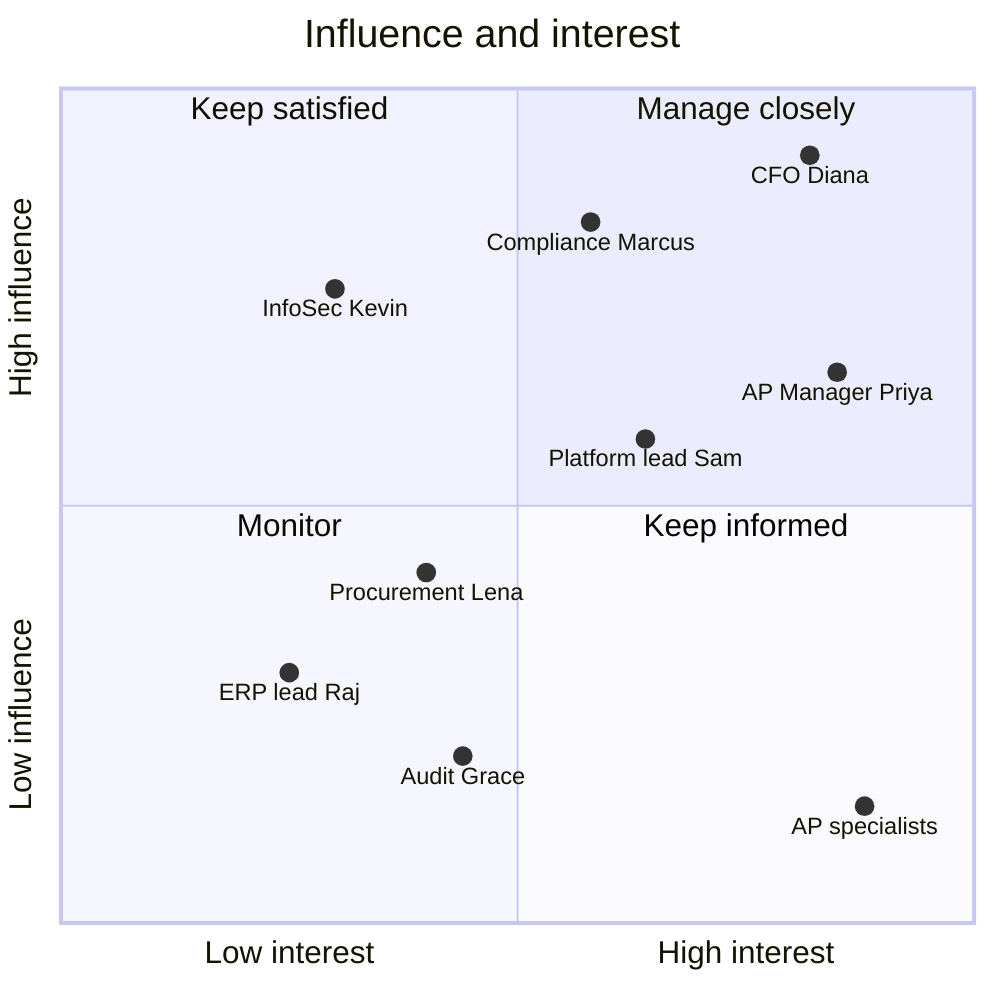

# From Pilot to Scale: Stakeholder & Productization Strategy for InvoiceMatch

**Strategy memo for the Silverbrook Financial leadership review** · Prepared by **Umashanker** · November 2026

> **Context.** InvoiceMatch is an AI-assisted accounts payable (AP) tool. Claude reads supplier invoices, written rules check them against purchase orders and contracts, and people approve every exception ([live product](https://invoicematch.onrender.com), [source](https://github.com/Umashanker1982/invoicematch)). Silverbrook Financial is fictional, and the pilot figures below are illustrative sample data.

## Executive summary

The 8-week pilot proved the technology: 100% field accuracy and zero wrong automatic approvals on the benchmark, at about $0.0002 per invoice. **Adoption is uneven.** One AP team uses InvoiceMatch for most invoices; the second still checks most invoices by hand, because it does not yet trust the explanations and fears being measured by the tool. Procurement and Internal Audit are barely engaged.

**Recommendation:** do not scale by mandate. Spend the next 90 days making the pilot team's success repeatable: fix the trust gaps the second team named, give each stakeholder an owner and a cadence, measure adoption with the scorecard below, and package InvoiceMatch as an internal product with clear service boundaries. Expand to full volume only when the day-90 gates are met.

## 1. Stakeholder map

Built with PMI stakeholder analysis (influence × interest), extended with each group's expected benefit, concern, and likely resistance.

| Stakeholder | Influence / interest | Expected benefit | Main concern | Likely resistance |
|---|---|---|---|---|
| **Diana, CFO** (sponsor) | High / High | 57% less manual effort; payback in ~7 months | ROI not proven at full volume | Low; turns into doubt if metrics slip |
| **Marcus, Compliance** | High / Medium | Every decision explained and logged | Automation bypassing approval limits | Medium: blocks any limit change without evidence |
| **Kevin, InfoSec** | High / Low | Governed AI instead of staff pasting invoices into chatbots | Data leaving the account; key misuse | Medium: slow security reviews |
| **Priya, AP Manager** | Medium / High | Team off overtime; exceptions explained | Being blamed for AI mistakes | Low; she is the champion |
| **Sam, AI Platform lead** | Medium / Medium | A reusable pattern for other teams | One-off code that cannot be reused | Low |
| **Lena, Procurement** | Low–Med / Medium | Price-drift data for vendor talks | More "fix this PO" requests | Medium: passive, slow responses |
| **Raj, ERP lead** | Low / Low | Fewer manual ERP status updates | Extra integration load | Low–medium: low priority |
| **Grace, Internal Audit** | Low / Medium | Faster, complete audit samples | Losing independent review | Low |
| **AP specialists** (6 people, two teams) | Low / High | Routine checking disappears | Job security; being monitored | **High in team B**: workarounds, manual re-checks |

**Key insight:** the people with the most interest have the least influence. The AP specialists decide whether the tool is used day to day, so their concerns must reach the sponsor quickly.

## 2. Engagement plan

| Stakeholder | Approach | Owner | Cadence | Escalation path | Success indicator |
|---|---|---|---|---|---|
| CFO | One-page scorecard; decisions only | FDE lead | Every 2 weeks | Steering committee | Funds release 1 at the day-90 review |
| Compliance | Rule-change reviews with evidence packs | AP Manager | Monthly; ad hoc for changes | CFO | No unapproved limit changes; sign-off in < 10 days |
| InfoSec | Security review of every release; access reviews | Platform lead | Each release; quarterly | CIO | Release reviews completed within SLA |
| AP Manager | Co-owner of the rollout and the backlog | FDE lead | Weekly | CFO | Team B adoption reaches target |
| AP specialists | Hands-on clinics; floor champions; "you said, we did" notes | AP Manager + champions | Weekly 30-minute session | AP Manager → steering committee | Satisfaction ≥ 4/5; manual re-checks falling |
| Procurement | Monthly mismatch report (price drift, wrong POs) | FDE analyst | Monthly | CFO | PO fixes within 3 days |
| ERP lead | Integration roadmap slot | Platform lead | Monthly | CIO | ERP write live by day 60 |
| Internal Audit | Weekly random sample of 50 decisions | AP Manager | Weekly | Audit Committee | Agreement ≥ 98% |

**Change model.** We follow Kotter's 8 steps, compressed into three moves. First, *urgency and coalition*: the CFO and AP Manager present the overtime and leakage numbers together. Second, *vision and quick wins*: team A's results are shared in team B's own words. Third, *anchoring*: InvoiceMatch becomes the standard AP procedure, with shadow mode retired only by the AP Manager.

## 3. Change and adoption scorecard

Measured with Prosci-style change metrics plus product usage data. Day-0 values are from the pilot; day-90 values are targets.

| Area | Metric | How measured | Day 0 | Day 90 target |
|---|---|---|---|---|
| Readiness | Staff who agree "I understand why we are changing" | Pulse survey | 58% | ≥ 85% |
| Training | Staff who completed role-based training | LMS records | 67% | 100% |
| Activation | Specialists who processed ≥ 20 invoices in a week | Audit log | 4 of 6 | 6 of 6 |
| Usage | Share of eligible invoices processed through InvoiceMatch | Audit log | 64% (team A 88%, team B 40%) | ≥ 90% both teams |
| Feature adoption | Exceptions resolved inside the review queue, not by email | Queue vs mailbox | 45% | ≥ 80% |
| Proficiency | Median time to resolve an exception | Queue timestamps | 3.1 days | ≤ 1 day |
| Satisfaction | AP user satisfaction (1–5) | Monthly survey | 3.4 | ≥ 4.2 |
| Support volume | Support tickets per 1,000 invoices | Service desk | 9 | ≤ 3 |
| Process compliance | Auto-approved invoices re-checked by hand (shadow work) | Sample of logs | 30% | ≤ 5% |
| Business value | Manual AP hours per month | Time study | 610 (baseline 790) | ≤ 450, on the way to 342 |
| Safety (guardrail) | Wrong automatic approvals | Audit sample | 0 | 0 (stop rule) |

**Reading the scorecard:** usage is the headline, but *shadow work* is the real signal. Team B re-checks auto-approved invoices because it does not trust them. Until that drops, the business value cannot arrive.

## 4. Productization strategy

| Element | Strategy |
|---|---|
| **Target users** | Primary: AP specialists and managers. Secondary: approvers (Controller, CFO), Procurement, Internal Audit. Next: other Silverbrook finance teams with document checks (expenses, vendor onboarding) |
| **Value proposition** | "Routine invoices approve themselves within your limits; every exception arrives explained, with the evidence attached." |
| **MVP / core offering** | PO-backed digital USD invoices: AI reading, 10 matching rules, approval routing, review queue, audit log, ERP status update |
| **Service boundaries** | *In:* reading, matching, routing, explanations, audit. *Out:* payments, PO or vendor changes, non-PO invoices (release 3). The AI never approves; rules and people do |
| **Onboarding** | 45-minute role training; sandbox with sample invoices; floor champion per team; two weeks in shadow mode per team before live use |
| **Support** | L1 service desk; L2 AP platform team with the runbook; L3 FDE/vendor engineering. Target: Sev 1 response in 15 minutes |
| **Governance** | Product owner: AP Manager. Technical owner: AI Platform lead. Rule and limit changes need Compliance sign-off; each release passes the accuracy and safety gates |
| **Funding / pricing logic** | Year 1: CFO-funded from savings (~$313k net/year). From year 2: internal chargeback per invoice processed (~$0.25 covers platform, support, and AI cost), so new teams pay for what they use |
| **Operational risks** | AI gateway outage (falls back to rules; people review); model drift (monthly benchmark); key exposure (15-minute rotation); team B rejection (see the 90-day plan) |

**Roadmap.**

| Horizon | Release | Scope | Gate to start |
|---|---|---|---|
| Now (0–3 months) | Release 1 at full volume | Both AP teams; trust fixes; ERP status write | Day-90 gates met |
| Next (3–6 months) | Release 2 | Bank-change verification workflow; Procurement price-drift report; scanned invoices | Release 1 stable for 6 weeks |
| Later (6–12 months) | Platform | "Safe document AI" module reused for expenses and vendor onboarding; non-PO invoices | Second internal customer funded |

## 5. Prioritized 90-day action plan

| Priority | Action | Owner | By day | Linked metric |
|---|---|---|---|---|
| 1 | Run listening sessions with team B; publish the top 5 trust gaps and their fixes | AP Manager + FDE lead | 10 | Readiness, satisfaction |
| 2 | Ship the two most requested fixes: contract link on the review screen; plain-language reason on every hold | FDE team | 30 | Shadow work, proficiency |
| 3 | Name two floor champions in team B; pair each with a team A champion | AP Manager | 14 | Activation |
| 4 | Complete role training for everyone; add a 15-minute refresher in team meetings | AP Manager | 30 | Training |
| 5 | Agree with HR and the CFO, in writing, that tool data is not used for individual performance reviews | CFO | 21 | Readiness, satisfaction |
| 6 | Turn on the ERP status write and retire the manual double entry | ERP lead | 60 | Usage, hours |
| 7 | Start the monthly Procurement mismatch report | FDE analyst | 45 | Proficiency |
| 8 | Publish the bi-weekly scorecard to the steering committee | FDE lead | From 14 | All |
| 9 | Hand L2 support to the AP platform team after two incident drills | Platform lead | 75 | Support volume |
| 10 | **Day-90 review:** scale to full volume if usage ≥ 90%, shadow work ≤ 5%, 0 wrong approvals, and satisfaction ≥ 4.2; otherwise extend by 30 days | CFO + steering committee | 90 | Gates |

**Why this order:** trust comes first (actions 1–5). Without it, removing double entry (6) or reporting usage (8) only increases pressure on team B. Ownership transfer (9) comes last, once the process is stable.

## Decision requested

Approve the 90-day plan, the named owners, and the day-90 gates. Confirm in writing that InvoiceMatch data will not be used to rate individual employees.

---

*Frameworks used: PMI stakeholder analysis; Prosci change-management metrics; Kotter's 8-step change model; product lifecycle staging (now / next / later).*
